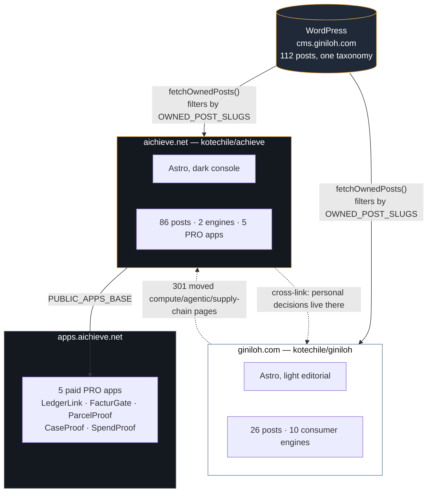

# The giniloh.com / aichieve.net split

Architecture and operating notes for the 2026 decision to split one site into two.

**This document is the "why". The "what" is executable:** which post belongs to which property
is not recorded here, it is recorded in `src/lib/site-content.ts` (giniloh) and
`AICHIEVE/src/lib/site-content.ts` (aichieve), because a list that exists in two places drifts.
Read this file to understand the shape; read the code to know the truth.

---

## Why two properties

They were one blog serving two incompatible audiences. A reader here spends their own money on a
career, a lease, an espresso machine. A reader there spends a company's money under an approval
chain, a vendor contract and an audit trail. Mixing them produced tools too soft for architects and
too heavy for individuals, and copy that was wrong for both.

| | giniloh.com | aichieve.net |
| --- | --- | --- |
| Positioning | The quantified professional | The enterprise command center |
| Spends | Their own money | The company's money |
| Audience | Tech workers, expats, analytical professionals | Enterprise IT architects, AI strategists, supply-chain managers |
| Tools | 10 consumer decision engines | 2 enterprise engines + 5 paid PRO apps |
| Aesthetic | White editorial, quiet steel blue | Graphite console, safety amber |
| Repo | `kotechile/giniloh` | `kotechile/achieve` |

## Topology



## One CMS, two front ends

**No content is duplicated and there is no second WordPress install.** Both properties read
`cms.giniloh.com`; the split is enforced in code, not infrastructure.

The WordPress taxonomy *cannot* express the split. It was authored as one site's blog, so it mixes
audiences: `major-purchases-assets` holds both an espresso-machine cost-per-use post and a KV-cache
concurrency post; `mental-models-strategy` holds both expat tax and Azure control-plane outages.
Category-based routing would mis-file about a third of the archive.

So ownership is an explicit per-post slug list, and **every** WordPress read funnels through
`fetchOwnedPosts()` in `src/lib/wordpress.ts`. That single choke point is load-bearing: a new fetch
path that skips it will silently cross-publish.

### Consequence you must know

A post published to WordPress appears on **neither** site until its slug is added to the relevant
`site-content.ts`.

This is deliberate — silence is safer than the same article going live on two domains with two
canonical URLs — but it is a change to the publishing workflow. A category-derived default with
slug overrides only for the genuinely ambiguous categories would reduce this to a handful of posts;
that refactor has not been done.

### Should aichieve get its own CMS?

No, not while one editorial team shares it. Revisit only if the two properties get **separate editors
with separate permissions**, or if giniloh.com's hosting needs to retire on an independent lifecycle.
Cloning the install is the wrong move: it creates the dual-publish problem immediately and the
installs diverge from that day forward. If a decision ever needs a second install, migrate content
*forward* rather than forking it.

## Redirect map

Moved from giniloh.com to aichieve.net during the split. giniloh serves the outbound 301s;
aichieve aliases the old `/calculators/` prefix internally (`astro.config.mjs` + `default.conf`).

| Old path (giniloh.com) | New path (aichieve.net) |
| --- | --- |
| `/calculators/gpu-compute/` | `/tools/gpu-compute/` |
| `/calculators/decision-intelligence/` | `/tools/master-asset-tco/` |
| `/calculators/` | `/tools/` |
| `/showcase`, `/pro-apps` | `/apps/` |
| 84 article slugs | same slug, different host |

**`/apps/` is a real route on aichieve.net and must never be redirected.** giniloh's nginx config
redirects `^/(apps|showcase|pro-apps)/?$` off-site; copying it verbatim 301'd aichieve's own
navigation to the other property.

## Deployment

Both properties are Astro static builds shipped as an nginx Docker image, deployed by Coolify.

```
git push → Coolify clones → docker build (npm ci → astro build) → nginx:stable-alpine + dist/
```

Two gotchas, both of which cost real downtime at launch:

1. **Coolify's `ports_exposes` defaults to 3000** and is written into the Traefik label
   `traefik.http.services.<id>.loadbalancer.server.port`. `EXPOSE` in the Dockerfile does **not**
   override it. If the image listens on 80, Traefik proxies to 3000, finds nothing, and returns
   **502 Bad Gateway** while the container reports `Up`. aichieve's nginx therefore listens on
   **both 80 and 3000**, so a mismatch cannot take the site down. Canonical fix: set the app port
   to 80 in Coolify.
2. **nginx behind Traefik must set `absolute_redirect off;`.** It otherwise builds redirect URLs
   from its own listen port and scheme, so readers following a redirect got
   `Location: http://aichieve.net:3000/tools/…` — internal port, plain http. With the directive it
   emits a relative `/tools/…`, which the browser resolves against the public https URL.

### Verifying a deploy

`AICHIEVE/scripts/verify.mjs` asserts the deploy contract — routes, redirect targets, the content
boundary, and the canonical host — and exits non-zero on violation:

```bash
cd AICHIEVE
npm run verify -- https://aichieve.net   # production
npm run verify                            # local container on :8899
```

This exists because `npm run check && npm run build` only prove the site *compiles*. Every launch
failure was a deploy-level one, and hand-checking with curl loops each time does not scale.

## Open work

- **giniloh.com still has its half outstanding.** It still serves `/calculators/gpu-compute/` and
  `/calculators/decision-intelligence/` (200, not a redirect), still shows the PRO/Apps nav tab,
  still advertises the two enterprise engines, and has no outbound 301s for the 84 moved posts.
- **`/default-share-image.png` 404s on giniloh.com.** `BaseLayout` references it on both properties
  but the file was never committed to either. aichieve.net now has one (generated, committed);
  giniloh.com still does not.
- **`www.aichieve.net` has no route.** DNS resolves, but Coolify has no domain entry for it, so it
  fails at TLS. Add `www.aichieve.net` as a domain on the app, or redirect it at DNS.
- **The PRO app host moved to `apps.aichieve.net`.** aichieve.net serves the directory that links
  to it, and `PUBLIC_APPS_BASE` is the single switch every property reads. The old
  `apps.giniloh.com` host answers 503 for every path, so no property may reference it.
